<!-- ═══════════════════════════════════════════════════════════ -->
<!--         ANIMATED CONTRIBUTION GRAPH (REAL DATA)              -->
<!--   Regenerated daily by .github/workflows/update-profile-art.yml -->
<!-- ═══════════════════════════════════════════════════════════ -->

<h3><code>tengkuzainul@github ~ $ ./contributions.sh</code></h3>

 
 

<!-- ═══════════════════════════════════════════════════════════ -->
<!--    ASCII PORTRAIT (LEFT) + REAL-TIME STATS CARD (RIGHT)    -->
<!--    Both SVGs are 840x880 for equal heights side-by-side    -->
<!-- ═══════════════════════════════════════════════════════════ -->

<h3><code>tengkuzainul@github ~ $ whoami</code></h3>

<table>
  <tr>
    <td valign="top"></td>
    <td valign="top"></td>
  </tr>
</table>

 
 

<!-- ═══════════════════════════════════════════════════════════ -->
<!--                     LINKS & SOCIALS                       -->
<!-- ═══════════════════════════════════════════════════════════ -->

<h3><code>tengkuzainul@github ~ $ ./links.sh</code></h3>

<b>Fullstack Web Developer · Information Systems (S.Kom) · IT Analyst</b>

 

<!-- Tech Stack Badges -->

  
  
  
  
  
  
  
  
  

 

<!-- Badges: Certifications & Visitors -->

  
  
  

 

 

<!-- ═══════════════════════════════════════════════════════════ -->
<!--                  DETAILS & STATS (ACCORDION)              -->
<!-- ═══════════════════════════════════════════════════════════ -->

<b>▶ Introduction &amp; Background</b>

 

Halo! 👋 Saya **Tengku Muhammad Zainul Aprilizar**, seorang **Fullstack Web Developer** tersertifikasi BNSP dan lulusan program studi **Sistem Informasi di Fakultas Ilmu Komputer, Universitas Muhammadiyah Riau (UMRI)**. Saya memiliki minat besar terhadap pengembangan *web* modern, khususnya dengan ekosistem **TALL Stack** (Tailwind, Alpine, Laravel, Livewire) dan **Vue.js / React**.

Selain keahlian teknis pemrograman, saya juga memiliki latar belakang kuat di bidang analisis sistem dan perencanaan strategis TI.

💼 **Informasi Karir & Pengalaman:**
- **Web Development:** Berpengalaman merancang dan membangun sistem informasi *end-to-end* (mulai dari Sistem Manajemen Keuangan UMKM, Sistem Pendataan Klinik Medis, hingga Portal BEM).
- **Penelitian Akademik & Analisis TI:** Turut serta sebagai penulis dalam penelitian *"Perencanaan Strategis SI/TI Menggunakan Analisis Ward & Peppard Pada Toko Trubus Pekanbaru"* yang dipublikasikan di **Jurnal CoSciTech** (2023).
- **UI/UX & Frontend:** Terbiasa merancang antarmuka web yang interaktif, responsif, serta *user-friendly*.
- **Tujuan Karir:** Saat ini saya terbuka untuk peluang *full-time*, *freelance*, kolaborasi *open-source*, maupun posisi sebagai *Web Programmer* dan *IT Analyst*.

 

<!-- ═══════════════════════════════════════════════════════════ -->
<!--                  FAVORITE OPEN SOURCE REPOS                 -->
<!-- ═══════════════════════════════════════════════════════════ -->

<b>▶ Favorite Open Source Repositories</b>

 
<table width="100%" border="0" cellspacing="0" cellpadding="4">
<tr>
<td width="50%" align="center">

</td>
<td width="50%" align="center">

</td>
</tr>
<tr>
<td width="50%" align="center">

</td>
<td width="50%" align="center">

</td>
</tr>
</table>

 

<!-- ═══════════════════════════════════════════════════════════ -->
<!--                  CONTRIBUTION SNAKE GAME                   -->
<!-- ═══════════════════════════════════════════════════════════ -->

<b>▶ Click for Contribution Snake</b>

 

<picture>
<source media="(prefers-color-scheme: dark)" srcset="https://raw.githubusercontent.com/tengkuzainul/tengkuzainul/output/snake-dark.svg">
<source media="(prefers-color-scheme: light)" srcset="https://raw.githubusercontent.com/tengkuzainul/tengkuzainul/output/snake.svg">

</picture>

